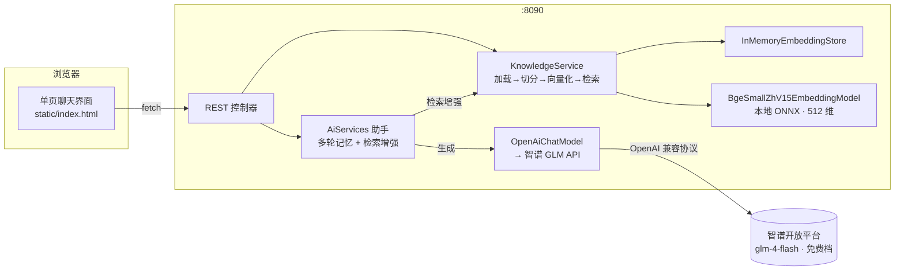

# 🎯 InterviewCopilot · Java 八股面试拷打助手

基于 **LangChain4j + Spring Boot 3** 的智能面试备战应用：把你的 Markdown 八股笔记变成可检索的知识库，
支持 **RAG 引用溯源问答** 与 **模拟面试拷打**（LLM 出题 → 你作答 → 基于你的笔记评分 + 追问）。

> 在线智谱 GLM 大模型 + 本地中文向量化（ONNX）的**混合架构**：一个 jar、一条命令跑起来，
> 不需要部署任何向量数据库、不需要 embedding API key。

## ✨ 功能

| 功能 | 说明 |
|---|---|
| 📚 知识库导入 | 服务端目录导入 / 网页上传 `.md`，切分后本地向量化入库，重复文件自动去重 |
| 💬 RAG 问答 | 检索最相关笔记段落注入提示词，回答附**真实引用来源**（文件名 + 相似度，服务端事实非模型自述） |
| 🧠 多轮记忆 | 按 sessionId 隔离的对话记忆窗口，支持连续追问 |
| 🔀 模式对比 | 前端可切换「RAG 增强 / 直连（无 RAG）」两种模式，直观对比检索增强效果 |
| 🎤 面试模式 | 按主题（JVM/Redis/并发/MySQL…从笔记文件名自动提取）出 N 道拷问题，逐题评分：得分、亮点、欠缺、参考要点、追问 |
| 🩹 异常兜底 | 未配置 key、路径非法、LLM 调用失败均返回结构化中文错误，不炸堆栈 |

## 🏗️ 架构



**混合架构的取舍**（详见下文「设计决策」）：

- **在线那一半**：对话生成用智谱 `glm-4-flash`（免费档模型，课程演示零成本，API 兼容 OpenAI 协议）
- **本地那一半**：中文向量化用 BAAI/bge-small-zh-v1.5 进程内 ONNX 模型——零 key、零部署、零网络开销；
  51 篇笔记全量向量化约 20 秒；向量存内存库（语料为百级段落，无需外部向量数据库）

## 🚀 快速开始（约 10 分钟）

**前置**：JDK 21+、Maven 3.9+、一个 [智谱 API Key](https://open.bigmodel.cn/)（注册即送额度，`glm-4-flash` 免费）

```bash
# 1. 配置 key（只进环境变量，永不进代码）
#    Windows:  setx ZHIPUAI_API_KEY "xxxx.xxxx"   （新开终端生效）
#    Linux/mac: export ZHIPUAI_API_KEY="xxxx.xxxx"

# 2. 构建与运行（首次构建会下载约 250MB 依赖，含 52MB 中文向量模型）
mvn -DskipTests package
java -jar target/interview-copilot-0.1.0-SNAPSHOT.jar

# 3. 导入语料（二选一）
#    a. 启动参数指定目录，启动即自动导入：
java -jar target/interview-copilot-0.1.0-SNAPSHOT.jar --rag.auto-import-dir=/path/to/你的笔记目录
#    b. 运行中调用接口：
curl -X POST localhost:8090/api/knowledge/import -H "Content-Type: application/json" -d '{"path":"/path/to/笔记目录"}'
```

浏览器打开 <http://localhost:8090> ——左侧可继续上传 `.md`、发起面试拷打；右侧对话框里
`RAG 增强模式` 会引用你的笔记作答，`直连模式` 则是裸模型回答，切着玩就能看出差别。

> 没配 key 也能启动：`/api/health`、知识库导入、检索诊断接口照常可用，仅 LLM 对话返回 503 提示。

## 🔌 接口一览

| 方法 | 路径 | 说明 |
|---|---|---|
| GET | `/api/health` | 存活检查（模型、key 状态、知识库文件数） |
| GET/POST | `/api/ask?q=` 或 `{"question"}` | 直连 LLM 问答（无 RAG，兼作对照组） |
| POST | `/api/chat` | `{"sessionId","question"}` → RAG 回答 + 引用来源列表 |
| POST | `/api/knowledge/import` | `{"path":"目录或.md文件"}` → 批量导入 |
| POST | `/api/knowledge/upload` | multipart `files` → 上传导入 |
| GET | `/api/knowledge/status` | 已导入文件数 |
| GET | `/api/knowledge/search?q=` | 检索诊断（只走向量检索，零 token 消耗） |
| GET | `/api/interview/topics` | 从笔记文件名前缀提取的面试主题 |
| POST | `/api/interview/start` | `{"topic","count"}` → 生成题目列表 |
| POST | `/api/interview/answer` | `{"sessionId","question","answer"}` → 评分 JSON |

## ⚙️ 配置项（application.yml）

| 键 | 默认 | 说明 |
|---|---|---|
| `llm.base-url` | `https://open.bigmodel.cn/api/paas/v4` | OpenAI 兼容端点，可换 DeepSeek 等 |
| `llm.model-name` | `glm-4-flash` | 模型名（智谱免费档，零成本） |
| `llm.api-key` | `${ZHIPUAI_API_KEY:}` | 只从环境变量注入 |
| `rag.segment-size` / `rag.segment-overlap` | 400 / 50 | 切分段长与重叠（字符） |
| `rag.max-results` / `rag.min-score` | 4 / 0.70 | 检索条数与相似度阈值（实测中文无关噪声分界） |
| `rag.auto-import-dir` | 空 | 启动时自动导入的语料目录 |

## 🧠 设计决策

1. **为什么用 `langchain4j-open-ai` 直连智谱，而不是专用 SDK？**
   智谱 GLM 官方 API 兼容 OpenAI 协议，直接复用 openai 客户端零额外依赖；
   `base-url`/`model-name` 全配置化，改两行即可切换任意 OpenAI 兼容服务
   （DeepSeek、通义千问、本地 Ollama 等）——本项目早期即从 DeepSeek 无缝迁移到智谱。
2. **为什么向量化跑在本地？** 在线 embedding 接口按量计费、需要第二条网络链路；
   bge-small-zh-v1.5 进程内 ONNX 模型 512 维中文向量，零 key、零网络开销、离线可用，
   质量/成本/部署复杂度三者的最优解。
3. **为什么不用 Milvus 等向量数据库？** 语料为百级段落，内存库 `InMemoryEmbeddingStore`
   绰绰有余，答辩演示零依赖。
4. **引用溯源怎么做才可信？** 检索命中由服务端返回（文件名 + 相似度得分），不依赖模型"自述"引用，
   从机制上杜绝编造来源。
5. **切分粒度**：八股笔记是 `##` 分节结构，400 字/段 + 50 重叠能保持小节语义完整；
   实验过给每段拼接文档标题前缀，反而放大标题词权重、把跨主题问题的目标文档挤出 top-N，故未采用。

## 📁 目录结构

```
src/main/java/com/interviewcopilot/
├── InterviewCopilotApplication.java   # 入口
├── config/
│   ├── LangChainConfig.java           # OpenAiChatModel → 智谱 GLM
│   ├── RagConfig.java                 # 本地 embedding + 内存向量库 + 检索器
│   └── AssistantConfig.java           # AiServices 组装（记忆 + 检索增强）
├── service/
│   ├── KnowledgeService.java          # 导入/切分/向量化/检索
│   ├── KnowledgeAssistant.java        # 声明式 RAG 助手接口
│   └── InterviewService.java          # 面试出题与评分
└── web/
    ├── ChatController.java            # /ask /chat /health
    ├── KnowledgeController.java       # /knowledge/*
    ├── InterviewController.java       # /interview/*
    └── dto/                           # 请求/响应 record
src/main/resources/
├── application.yml                    # 全部可调参数
└── static/index.html                  # 单页前端（零构建工具）
```

## 🧪 已验证

- 51 篇真实八股笔记（Java/JVM/并发/MySQL/Redis/Spring/网络/MyBatis）全量导入：609 段向量，约 21 秒
- 检索质量抽测：`Redis分布式锁怎么实现`→0.852 命中目标笔记；无关问题（"今天天气怎么样"）被
  `min-score=0.70` 阈值正确拦截为空
- 上传重复文件自动跳过；未配置 key 时全部 LLM 接口返回结构化提示
