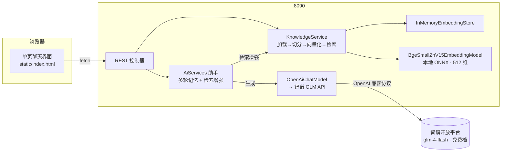
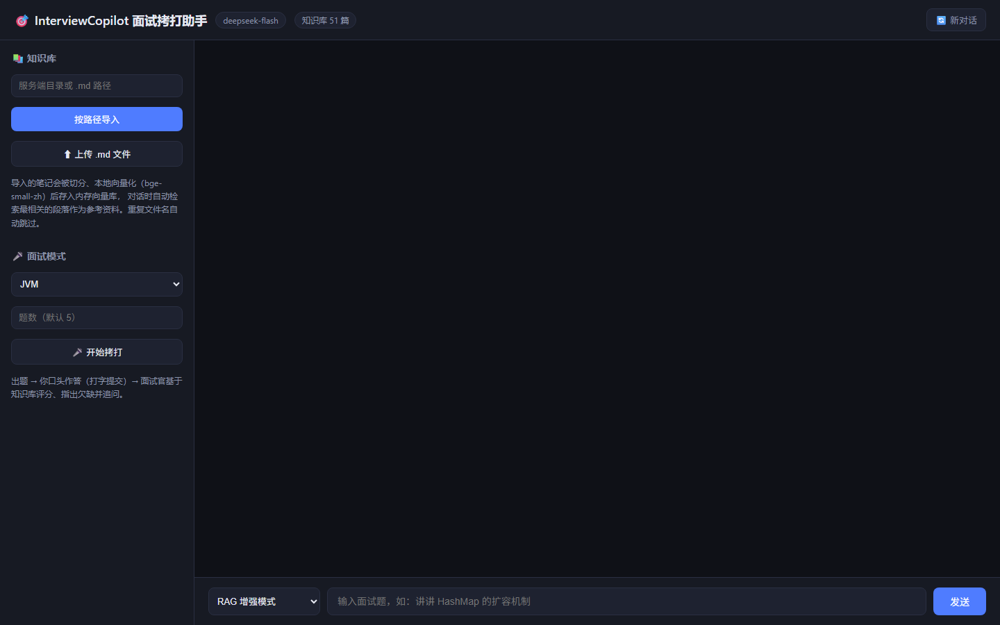
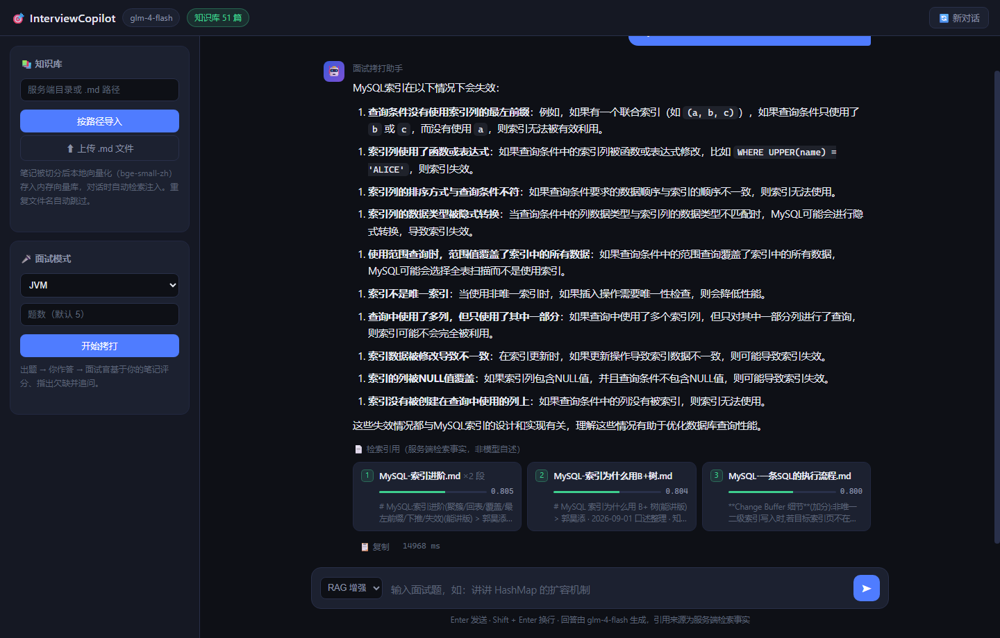
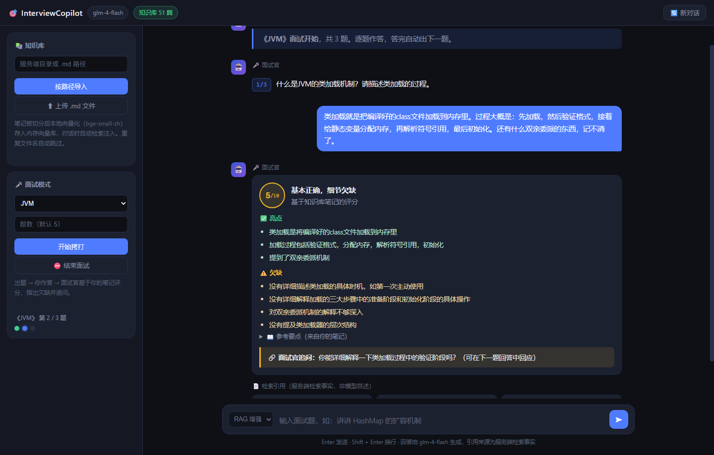

# 🎯 InterviewCopilot · Java 八股面试拷打助手

基于 **LangChain4j + Spring Boot 3** 的智能面试备战应用：把你的 Markdown 八股笔记变成可检索的知识库，
支持 **RAG 引用溯源问答** 与 **模拟面试拷打**（LLM 出题 → 你作答 → 基于你的笔记评分 + 追问）。

> 在线智谱 GLM 大模型 + 本地中文向量化（ONNX）的**混合架构**：一个 jar、一条命令跑起来，
> 不需要部署任何向量数据库、不需要 embedding API key。

## ✨ 功能

| 功能 | 说明 |
|---|---|
| 📚 知识库导入 | 服务端目录导入 / 网页上传 `.md`，切分后本地向量化入库，重复文件自动去重 |
| 💬 RAG 问答 | 检索最相关笔记段落注入提示词，回答附**真实引用来源**（文件名 + 相似度，服务端事实非模型自述） |
| 🧠 多轮记忆 | 按 sessionId 隔离的对话记忆窗口，支持连续追问 |
| 🔀 模式对比 | 前端对话固定走 RAG；直连（无 RAG）保留为 `/api/ask`、`/api/ask/stream` 接口，作开发/评测对照组（见下方实测） |
| 🎤 面试模式 | 按主题（JVM/Redis/并发/MySQL…从笔记文件名自动提取）出 N 道拷问题，逐题评分：得分、亮点、欠缺、参考要点；追问不设轮数上限，拷打到底；**综合模式**跨主题混合出题，评分检索按题所属主题逐题限域，复盘报告按主题分列薄弱项 |
| 🔔 复盘报告 | 面试收卷后**后台异步生成**复盘报告（逐题得分 / 总体评价 / 薄弱项归类 / 建议复习笔记 / 下一步），右上角铃铛提醒，可预览、复制、下载 `.md`；「建议复习」只从本场真实检索命中的笔记里挑（服务端白名单校验，杜绝编造文件名） |
| 🩹 异常兜底 | 未配置 key、路径非法、LLM 调用失败均返回结构化中文错误，不炸堆栈 |

## 🏗️ 架构



**混合架构的取舍**（详见下文「设计决策」）：

- **在线那一半**：对话生成用智谱 `glm-4-flash`（免费档模型，课程演示零成本，API 兼容 OpenAI 协议）
- **本地那一半**：中文向量化用 BAAI/bge-small-zh-v1.5 进程内 ONNX 模型——零 key、零部署、零网络开销；
  51 篇笔记全量向量化约 20 秒；向量存内存库（语料为百级段落，无需外部向量数据库）

## 🚀 快速开始（约 10 分钟）

**前置**：JDK 21+、Maven 3.9+、一个 [智谱 API Key](https://open.bigmodel.cn/)（注册即送额度，`glm-4-flash` 免费）

```bash
# 1. 配置 key（只进环境变量，永不进代码）
#    Windows:  setx ZHIPUAI_API_KEY "xxxx.xxxx"   （新开终端生效）
#    Linux/mac: export ZHIPUAI_API_KEY="xxxx.xxxx"

# 2. 构建与运行（首次构建会下载约 250MB 依赖，含 52MB 中文向量模型）
mvn -DskipTests package
java -jar target/interview-copilot-0.1.0-SNAPSHOT.jar

# 3. 导入语料（二选一）
#    a. 启动参数指定目录，启动即自动导入：
java -jar target/interview-copilot-0.1.0-SNAPSHOT.jar --rag.auto-import-dir=/path/to/你的笔记目录
#    b. 运行中调用接口：
curl -X POST localhost:8090/api/knowledge/import -H "Content-Type: application/json" -d '{"path":"/path/to/笔记目录"}'
```

浏览器打开 <http://localhost:8090> ——左侧可继续上传 `.md`、发起面试拷打；对话框里提问会
检索你的笔记作答并附引用来源。

> 没配 key 也能启动：`/api/health`、知识库导入、检索诊断接口照常可用，仅 LLM 对话返回 503 提示。

## 🔌 接口一览

| 方法 | 路径 | 说明 |
|---|---|---|
| GET | `/api/health` | 存活检查（模型、key 状态、知识库文件数） |
| GET/POST | `/api/ask?q=` 或 `{"question"}` | 直连 LLM 问答（无 RAG，兼作对照组） |
| POST | `/api/chat` | `{"sessionId","question"}` → RAG 回答 + 引用来源列表 |
| POST | `/api/chat/stream` | 同上，SSE 流式：`sources`（检索命中，生成前即达）→ `token`\* → `done` |
| POST | `/api/ask/stream` | 直连流式（无 RAG）：`token`\* → `done` |
| POST | `/api/knowledge/import` | `{"path":"目录或.md文件"}` → 批量导入 |
| POST | `/api/knowledge/upload` | multipart `files` → 上传导入 |
| GET | `/api/knowledge/status` | 已导入文件数 |
| GET | `/api/knowledge/search?q=&limit=N` | 检索诊断（只走向量检索，零 token 消耗；limit 默认 4） |
| GET | `/api/interview/topics` | 从笔记文件名前缀提取的面试主题 |
| POST | `/api/interview/start` | `{"topic","count"}` → 生成题目列表；`topic` 传「综合」时跨主题混合出题，响应含逐题 `topics` |
| POST | `/api/interview/turn` | `{"sessionId","answer"|"giveUp"|"checkpoint"|"advance"}` → 拷打循环一轮：追问 / 中途评分（本题不结束）/ 终评+下一题 |
| GET | `/api/interview/report?sessionId=` | 复盘报告状态与产物（`status`: `generating` / `ready` / `failed` / `none`），收卷后前端轮询此接口 |
| POST | `/api/interview/report` | `{"sessionId"}` → 复盘报告失败重试 / 重新生成 |
| POST | `/api/interview/answer` | `{"sessionId","question","answer"}` → 单轮评分（无状态诊断用） |

## ⚙️ 配置项（application.yml）

| 键 | 默认 | 说明 |
|---|---|---|
| `llm.base-url` | `https://open.bigmodel.cn/api/paas/v4` | OpenAI 兼容端点，可换 DeepSeek 等 |
| `llm.model-name` | `glm-4-flash` | 模型名（智谱免费档，零成本） |
| `llm.api-key` | `${ZHIPUAI_API_KEY:}` | 只从环境变量注入 |
| `rag.segment-size` / `rag.segment-overlap` | 400 / 50 | 切分段长与重叠（字符） |
| `rag.max-results` / `rag.min-score` | 4 / 0.70 | 检索条数与相似度阈值（实测中文无关噪声分界） |
| `rag.auto-import-dir` | 空 | 启动时自动导入的语料目录 |

## 🧠 设计决策

1. **为什么用 `langchain4j-open-ai` 直连智谱，而不是专用 SDK？**
   智谱 GLM 官方 API 兼容 OpenAI 协议，直接复用 openai 客户端零额外依赖；
   `base-url`/`model-name` 全配置化，改两行即可切换任意 OpenAI 兼容服务
   （DeepSeek、通义千问、本地 Ollama 等）——本项目早期即从 DeepSeek 无缝迁移到智谱。
2. **为什么向量化跑在本地？** 在线 embedding 接口按量计费、需要第二条网络链路；
   bge-small-zh-v1.5 进程内 ONNX 模型 512 维中文向量，零 key、零网络开销、离线可用，
   质量/成本/部署复杂度三者的最优解。
3. **为什么不用 Milvus 等向量数据库？** 语料为百级段落，内存库 `InMemoryEmbeddingStore`
   绰绰有余，答辩演示零依赖。
4. **引用溯源怎么做才可信？** 检索命中由服务端返回（文件名 + 相似度得分），不依赖模型"自述"引用，
   从机制上杜绝编造来源。
5. **切分粒度**：八股笔记是 `##` 分节结构，400 字/段 + 50 重叠能保持小节语义完整（实测 51 篇 / 17.8 万字切 609 段，平均段长 293 字，递归切分尊重段落边界不拦腰截断）；
   实验过给每段拼接文档标题前缀，反而放大标题词权重、把跨主题问题的目标文档挤出 top-N，故未采用。
   注意 400 已贴近 bge-small-zh 的 512 token 输入上限，段长再大 embedding 会被截断——未来若要加大粒度，需先换长上下文向量模型（如 bge-m3）；两个参数均为 `application.yml` 配置项（`rag.segment-size` / `rag.segment-overlap`），调参无需改代码。

## 📁 目录结构

```
src/main/java/com/interviewcopilot/
├── InterviewCopilotApplication.java   # 入口
├── config/
│   ├── LangChainConfig.java           # OpenAiChatModel → 智谱 GLM
│   ├── RagConfig.java                 # 本地 embedding + 内存向量库 + 检索器
│   └── AssistantConfig.java           # AiServices 组装（记忆 + 检索增强）
├── service/
│   ├── KnowledgeService.java          # 导入/切分/向量化/检索
│   ├── KnowledgeAssistant.java        # 声明式 RAG 助手接口
│   └── InterviewService.java          # 面试出题与评分
└── web/
    ├── ChatController.java            # /ask /chat /health
    ├── KnowledgeController.java       # /knowledge/*
    ├── InterviewController.java       # /interview/*
    └── dto/                           # 请求/响应 record
src/main/resources/
├── application.yml                    # 全部可调参数
└── static/index.html                  # 单页前端（零构建工具）
```

## 📸 界面

| 首页 | RAG 引用溯源 | 面试评分 |
|---|---|---|
|  |  |  |

单文件 `static/index.html`（零构建、零 CDN 依赖），参考 2025 年主流 AI 助手（Perplexity / ChatGPT 等）的交互惯例实现：

- **SSE 流式打字机**：`sources` 事件先于生成到达——先看检索到了哪些笔记，再看回答逐字输出（两阶段状态提示），支持随时「停止生成」
- **文档式消息布局**：回答通栏渲染（非气泡），手写 Markdown 渲染器——代码块带语言标签和一键复制、GFM 表格、加粗/引用/列表，流式半成品代码块也能正确渲染
- **引用溯源卡片**：按来源文件分组、每段命中带相似度条与片段预览，引用是服务端检索事实而非模型自述
- **面试拷打循环**：每题面试官刨根追问**不设轮数上限**（拷打到底，无欠缺才收卷；答不上可一键「直接打分」，中途评分后可接受分数跳题）；答完出逐题得分汇总卡。评分卡只展示分数/亮点/欠缺/参考要点——检索引用不呈现在界面，改为服务端 `[面试留痕]` 日志（每轮判定、追问、终评、得分台账全量落日志）
- **评分与追问的多道防线**：①放弃不打零分——判定模型实测会被最后的「不知道」锚定清零，服务端剔除放弃轮、用此前各轮实质作答综合重评；②放弃词表整句正则——「不知道/不能/没法/说不上来/直接打分吧」等整句放弃信号服务端秒判终评，不赌模型听话；③重复追问判重——模型把问过的追问原样重问时（实测会出现），归一化判重（相同/互含/换措辞相似）强制终评，绝不出现两个一模一样的问题；④有欠缺不收卷——判定模型「充分覆盖」偏宽松（一句话作答也能 9 分直接终评），只要仍有欠缺且候选人没放弃，服务端强制针对欠缺继续追问；⑤跨题查重——出题约束各题考点独立，推进下一题前再按「已考内容清单」（各题题干 + 实际追问过的问题）查重，重复/衍生即换未覆盖的考点
- **中途评分检查点**：任何时刻可点「中途评分」看当前得分与欠缺，本题不结束——针对欠缺继续补答，追问会锁定欠缺一层层递进，分数随补答上涨（实测 5→7）；满意了点「接受分数下一题」（评分后无新作答则原样采用，不二次评分）。完整覆盖考点时欠缺可为空、可给 9-10 分——满分罕见但可达，不为凑数编造欠缺
- **复盘报告铃铛**：收卷即后台异步生成复盘报告（一次 LLM 分析约 15~40s，不卡收卷响应）——生成中铃铛黄点闪烁、完成绿点提示；报告含逐题得分表、总体评价、薄弱项归类（按知识领域归并 + 怎么补）、建议复习笔记、下一步行动，可页内预览 / 复制 / 下载 `.md`。两道防线：**白名单闸**——「建议复习」文件名只能来自本场真实检索命中的笔记，模型编造的文件名被服务端过滤归一；**确定性渲染**——LLM 只输出结构化 JSON，Markdown 版式由服务端拼装。历史报告落 localStorage，刷新不丢；页面刷新时未完成的报告自动续轮询
- **工程细节**：空状态建议问题一键发送、Enter/Shift+Enter、输入框自增高、失败重试卡、对话记录 localStorage 持久化（刷新不丢）

## 🧪 实测评测（2026-10-29 · glm-4-flash · 51 篇真实笔记）

**检索质量：10 问抽测**（`/api/knowledge/search` 诊断接口，零 token 消耗）

| # | 问题 | Top-1 命中 | 相似度 |
|---|---|---|---|
| 1 | synchronized 锁升级过程 | 并发-ReentrantLock与synchronized | **0.895** |
| 2 | MySQL 索引失效场景 | MySQL-索引进阶 | 0.806 |
| 3 | Spring Bean 生命周期 | Spring-Bean生命周期 | 0.809 |
| 4 | TCP 为什么三次握手 | 网络-TCP三次握手与四次挥手 | 0.864 |
| 5 | volatile 可见性/有序性原理 | 并发-JMM与happens-before | 0.843 |
| 6 | Redis RDB/AOF 区别 | ~~JVM-垃圾收集器~~ ❌ | 0.831 |
| 7 | HashMap 扩容机制 | Java集合-List与Map家族 | 0.803 |
| 8 | JVM 运行时内存区域 | JVM-内存区域 | 0.857 |
| 9 | MyBatis 一/二级缓存 | MyBatis-核心三件套 | 0.884 |
| 10 | 线程池核心参数与流程 | 并发-线程池 | 0.852 |

**9/10 Top-1 即目标笔记**。第 6 问是真实 miss：查询词「持久化」与 JVM 笔记里的「持久代」字面撞车；
换问法「RDB快照和AOF日志的区别」即正确召回 `Redis-持久化.md`（0.822）——bge-small 级模型对字面
重叠敏感的已知边界，诚实记录在此。

**RAG vs 直连（同 10 问，`/api/chat` vs `/api/ask`）**

- 10/10 RAG 命中，回答锚定笔记内容，来源由**服务端检索事实**返回（非模型自述）
- 典型差异：问「volatile 是怎么保证可见性和有序性的」，**直连模式跑偏讲成 C/C++ 的 volatile 语义**；
  RAG 模式锚定 `并发-JMM与happens-before.md`，正确围绕 Java 内存模型作答
- 无关问题（「今天适合穿什么衣服」）检索为空（低于 0.70 阈值），模型先声明「知识库暂无此内容」
  再给通用回答——不编造引用
- 延迟：直连 9~18s、RAG 8~21s（本地向量检索仅增加 1~3s）

**多轮记忆与面试评分**

- 同 sessionId 三连问，第二问「超过负载因子之后**它**会做什么」——模型准确接住「它 = HashMap」的指代
- 评分校准：答对类加载五阶段但漏双亲委派 → **5/10**，欠缺点精准指向漏讲部分；几乎空白的回答 → **3/10**；
  参考要点检索自 `JVM-类加载.md`，追问直指回答暴露的弱点
- 复盘报告：2 题 JVM 面试（堆栈 8 分 + 类加载 0 分）收卷后约 **16s** 生成——薄弱项按「类加载机制 / 内存模型 / 垃圾收集器」三个知识领域归并，
  建议复习清单 `JVM-类加载.md` 等 3 篇全部为本场真实检索命中（白名单校验通过），总体评价准确指出"内存模型有底、类加载薄弱"的得分结构

**其他**：51 篇全量导入 609 段向量约 21s；上传重复文件自动跳过；未配置 key 时全部 LLM 接口返回结构化提示
